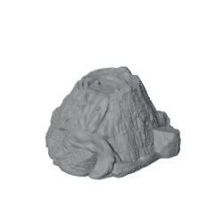


FDM-printed Age of Sigmar terrain, used on the Spearhead board and on full-size tables.


## Pieces

[AOS 4 Skaventide Terrain Equivalent](https://www.thingiverse.com/thing:6724571) by ChickenFPV, CC BY-SA: `small_AOS_terrain.stl` + `big_AOS_terrain.stl`. Printed at 0.4mm nozzle, 0.2mm layer height.

Two lava volcanoes from the [Mythos lava set]() at 100%: `21_01_Volcano_01_fixed.stl` and `21_01_Volcano_04_fixed.stl`. Large features, used as the Spearhead large terrain on Aqshy.

## Finishing

Sealed and textured with the acrylic floor-primer mixes from the [floor primer note]().

## Status

| Render | Piece | Needed | Printed | Finished |
|--------|-------|-------:|--------:|---------:|
| | Skaventide small | | | |
| | Skaventide big | | | |
| | Hut | | | |
| | Ruin walls | | | |
|  | Volcano 01 (lava) | | 1 | |
|  | Volcano 04 (lava) | | 1 | |
