
A volcanic terrain set for the Age of Sigmar table at Mythos, built with a friend to match the store's lava mat.


## Models

The STLs come from a friend and need repair before they print. Printed on the Anycubic Kobra X: 0.2mm layers, 0.4mm nozzle, high-quality profile.

| Render | Terrain | STL file | Scale | Printed size (mm, X×Y×Z) | Needed | Printed | Notes |
|--------|---------|----------|------:|--------------------------|-------:|--------:|-------|
| 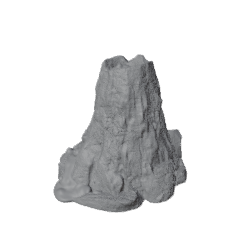 | Medium obstacle | `21_01_Volcano_02_fixed.stl` | 100% | 167×190×151 | 2 | 1 |  |
| 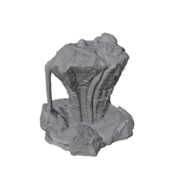 | Medium obstacle | `21_01_Volcano_04_fixed.stl` | 88% | 174×170×158 | 2 | 0 |  |
| 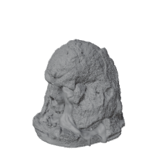 | Medium Place of Power | `21_01_Volcano_05_fixed.stl` | 100% | 164×185×156 | 2 | 1 |  |
| 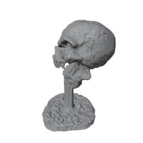 | Small Place of Power | `lavaPiece1correction.stl` | 100% | 37×40×54 | 2 | 0 |  |
| 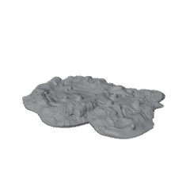 | Medium forest | `21_01_Volcano_03.stl` | 100% | 154×135×16 | 3 | 0 | Floating geometry |
| 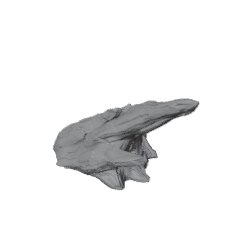 | Medium forest | `rocks.stl` | 100% | 99×53×52 | 2 | 2 |  |
| 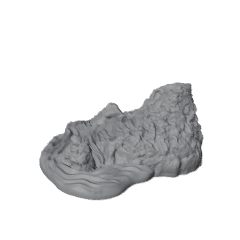 | Medium forest | `lavaPiece4correction.stl` | 100% | 38×42×19 | 1 | 1 |  |
| 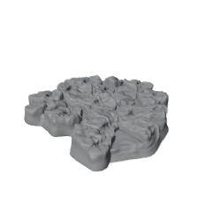 | Medium forest | `lavaPiece5correction.stl` | 100% | 42×39×6 | 1 | 1 |  |
| 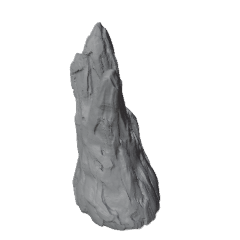 | Small forest | `rock2.stl` | 100% | 48×46×85 | 3 | 3 |  |
| 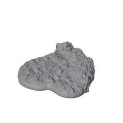 | Small forest | `lavaPiece2correction.stl` | 100% | 55×57×16 | 1 | 1 |  |
| 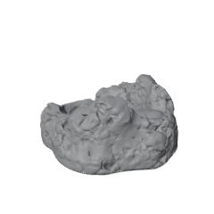 | Small forest | `lavaPiece3correction.stl` | 100% | 46×41×18 | 1 | 1 |  |
| 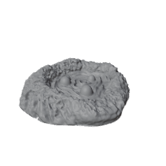 | Small forest | `lavaPiece6correction,stl.stl` | 100% | 31×35×8 | 2 | 2 |  |

Forest pieces are totals across the three medium or three small forests. Sizes follow the [AoS rules size bands](): each piece together with its base fits the medium footprint (178mm on the narrow side), which is why Volcano 04 prints at 88%.

## Bases

Terrain pieces are glued to 3mm hardboard bases with irregular, organic outlines (kidney and blob shapes), laser cut. Two outline designs per size, split evenly.

Large bases (9) carry the medium features: 4 obstacles, 2 Places of Power and 3 forests. Small bases (5) carry the small features: 2 Places of Power and 3 forests.

| Outline | Base | Size (mm) | Needed | Cut file |
|---------|------|-----------|-------:|----------|
| 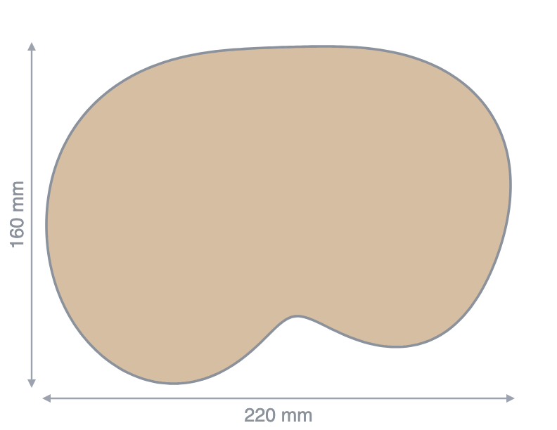 | Large A | 220×160×3 | 5 | [SVG](downloads/base-large-a.svg) |
| 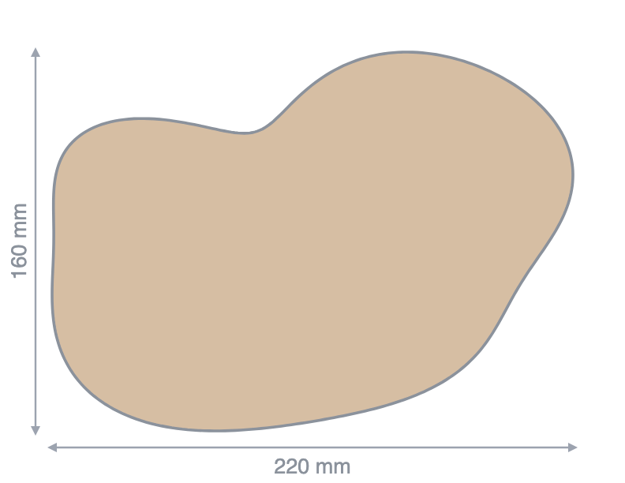 | Large B | 220×160×3 | 4 | [SVG](downloads/base-large-b.svg) |
| 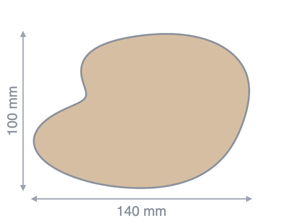 | Small A | 140×100×3 | 3 | [SVG](downloads/base-small-a.svg) |
| 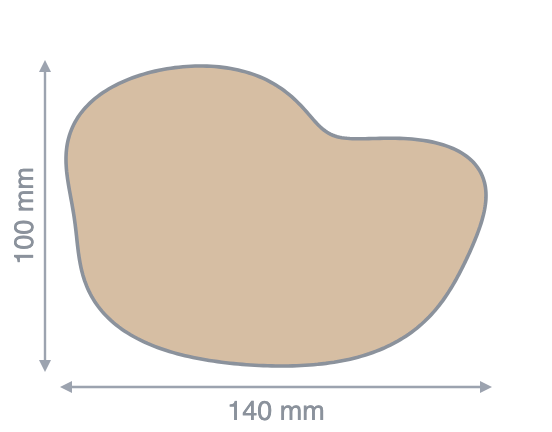 | Small B | 140×100×3 | 2 | [SVG](downloads/base-small-b.svg) |

The cut files are true size in mm with a 0.1mm red cut line. Script (plain Python, no dependencies): [make_bases.py]().

## Finishing

Sealed and textured with the acrylic floor-primer mixes from the [floor primer note]().

## Open

- Volcano 03 has floating geometry and needs repair before it prints.
